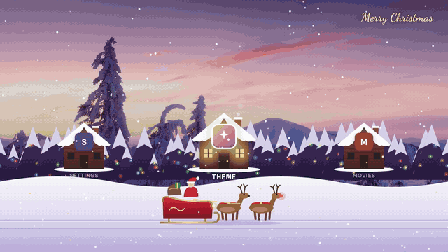

# Snow Village

A Christmas home screen for Android TV and Google TV. Santa's sleigh glides along a snowy road
past your apps; each app sits in a gift box, a bauble, a little house or a snow globe.

[](docs/demo.mp4)

*Click the preview for the full-quality video (16 s, MP4).*

- 4 icon types: Gift box, Bauble, House, Snow globe
- 7 sceneries: Dusk, Pink dawn, Before dawn, Sunny day, Aurora, Snow village, Festive night
- 2 styles: Photo and Origami
- Rotating Christmas greetings, falling snow, works fully offline (no internet permission)

## Controls

| Remote | On the road | In the Theme panel |
|---|---|---|
| ← → | Drive to the previous / next app (loops forever) | Change the option (the scene updates live) |
| ↑ ↓ | | Move between Icon type, Scenery, Style |
| OK | Open the app | Save and close |
| Back | Leave Snow Village (unless it is your Home screen) | Cancel and close |
| Menu | Open the Theme panel (only on TVs that pass Menu to apps) | |

The **Theme** stop on the road opens the same panel and works on every TV; some TVs (for example
Hisense/Toshiba) keep the Menu button for their own picture and sound menu. Your choice is remembered.

## Install

You need to be comfortable installing an APK yourself. Download `snow-village.apk` from the
[Releases](../../releases) page.

### Option 1: use it as an app (any Android TV / Google TV, no adb)

Install the APK (for example with the *Downloader* app, *Send Files to TV*, a USB stick, or
`adb install snow-village.apk`). Open **Snow Village** from your app list. Pressing Home returns to
your normal home screen.

Snow Village can also act as a Home screen, so after installing it some TVs ask once which Home app
to use. Pick your usual one and choose **Always**.

### Option 2: make it your Home screen (for developers)

**Android TV boxes** that ask "which Home app?" when you press Home: pick Snow Village.

**Google TV** never asks, so it needs adb. These steps replace the Google TV home screen; nothing is
uninstalled and every step can be undone.

```sh
adb install snow-village.apk
adb shell pm disable-user --user 0 com.google.android.apps.tv.launcherx
adb shell pm disable-user --user 0 com.google.android.tungsten.setupwraith   # recovery screen that otherwise grabs Home
adb shell cmd package set-home-activity --user 0 io.github.snowvillage/.MainActivity
```

To undo:

```sh
adb shell pm enable com.google.android.tungsten.setupwraith
adb shell pm enable com.google.android.apps.tv.launcherx
```

Re-enable both before a factory reset, and check again after big system updates, which may switch them back on.

## Build from source

Needs JDK 17+ and the Android SDK command-line tools with `build-tools;34.0.0` and `platforms;android-34`.
No Gradle.

```sh
./test.sh     # core tests
./build.sh    # -> build/snow-village.apk
```

Without settings, `build.sh` signs with a throwaway `debug.keystore`, good for trying things out.
For a release, choose a password and run `SNOW_KEYSTORE_PASS=... ./build.sh`; it signs with
`release.keystore` (created on first use; `SNOW_KEYSTORE` picks another file). Keep the keystore and
password private: an update installs over an older copy only when both are signed with the same key.
Keystores are git-ignored.

The whole screen is one web page, `assets/web/index.html`. Open it in a desktop browser to work on it
with the arrow keys (it shows demo apps there). On the TV, `Bridge.java` gives the page the real app
list and opens apps; `MainActivity.java` passes Back and Menu to it.

## License

Code: MIT. Photographs and fonts: see [CREDITS.md](CREDITS.md).
